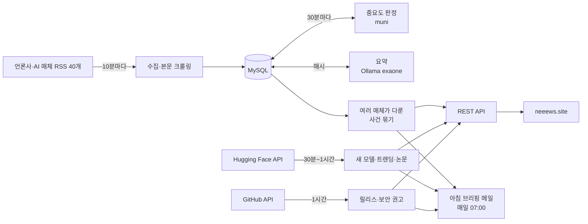

# neeews 백엔드

세상에서 일어나는 중요한 일과 개발 소식을, 찾아다니지 않아도 빠르게 알 수 있게 해 주는 뉴스 서비스의 백엔드입니다.

- 서비스: https://neeews.site
- 프론트엔드: https://github.com/neeews/frontend

## 왜 만들었나

중요한 일을 늦게 알거나 아예 모르고 지나치는 일이 잦았습니다. 개발 소식은 더 심했습니다. 어떤 모델이 새로 나왔는지, 내가 쓰는 프레임워크에 보안 문제가 생겼는지 늘 한발 늦게 알았습니다. 그래서 정보를 더 많이 모으기보다, 고르고 전달하는 데 집중했습니다.

- **고른다:** 클릭이 많은 기사가 아니라 "놓치면 손해인" 기사를 고릅니다. 중요도 판정 모델이 걸러내고, 여러 매체가 함께 다룬 사건을 위로 올립니다.
- **줄인다:** 기사는 한두 문장 요약으로 먼저 읽습니다.
- **먼저 온다:** 아침 브리핑 메일이 하루치 소식을 한 통으로 보냅니다.
- **개발자에게 필요한 것을 따로 모은다:** 새 AI 모델과 논문, 내가 쓰는 기술의 릴리스와 보안 권고를 한곳에서 봅니다.

## 주요 기능

**뉴스**
- 언론사와 AI·개발 매체의 RSS 피드 40개를 10분마다 수집하고, 첫 조회 때 원문 본문과 이미지를 가져옵니다.
- 중요도 판정 모델(muni)이 기사마다 '중요' 확률을 매기고, 중요 기사는 Ollama(exaone3.5:2.4b)로 한국어 요약을 만듭니다.
- **오늘의 뉴스:** 여러 매체가 함께 다룬 사건만 묶어, 보도한 매체가 많은 순으로 요약문을 보여줍니다.
- **이번 주 꼭 알아야 할 일:** 최근 7일의 사건을 같은 방식으로 묶은 Top 10입니다. 로그인하면 이미 읽은 사건을 표시합니다.
- **핫이슈:** KOMORAN 형태소 분석으로 시간대별 급상승 주제를 뽑고, 주제마다 기사를 고릅니다.
- 카테고리별 헤드라인, 속보·최신·인기 목록, 한글 부분 문자열 검색(ngram FULLTEXT)을 제공합니다.

**개발 소식**
- **AI/개발 카테고리:** AI타임스, GeekNews, OpenAI, Hugging Face 블로그, Google DeepMind, Google AI를 수집합니다.
- **새 AI 모델 출시:** Qwen·DeepSeek·Meta·Google 등 14개 조직의 Hugging Face 새 모델을 추적합니다. 양자화 사본은 빼고, 좋아요가 기준을 넘은 출시작만 보여줍니다. 모델마다 기반 모델, 라이선스와 상업 이용 가능 여부, 모델 카드를 요약한 한국어 설명이 붙습니다.
- **트렌딩 모델·논문:** 요즘 뜨는 모델 Top 10을 보여주고, Hugging Face Daily Papers는 전체(최신순)와 날짜·주·월별(추천순)로 지난 논문까지 찾아볼 수 있습니다.
- **개발 스택 소식:** Spring Boot·Spring Security·Hibernate 등의 새 정식 릴리스와, 이 프로젝트 의존성에 걸린 보안 권고(CVE)를 영향 버전·수정 버전과 함께 보여줍니다.

**아침 브리핑 메일**
- 신청한 사용자에게 매일 아침 7시(한국 시간)에 오늘의 주요 사건, AI·개발 기사, 새로 뜬 모델, 개발 스택 소식을 메일 한 통으로 보냅니다.
- 수신 거부는 메일 앱의 원클릭 해지 표준(RFC 8058)을 지원합니다. 메일 보안 검사기가 링크를 미리 열어도 해지되지 않게, 링크는 확인 화면만 보여주고 버튼을 눌러야 해지됩니다.

**사용자·관리자**
- 이메일 인증 회원가입, JWT 로그인, 비밀번호 재설정, 북마크, 읽은 기사·검색 기록, 건의하기
- 관리자: 수집·판정·요약 파이프라인 상태 확인, 중요도 라벨링 도구, 건의 관리, 방문자 통계, 브리핑 미리보기·테스트 발송

## 동작 구조



중요도 판정 서버(muni)와 Ollama는 이 저장소 밖에서 같은 서버의 별도 프로세스로 돕니다. muni는 "놓치면 손해인가"를 기준으로 매긴 라벨(`labels/`)로 학습한 HIGH/LOW 분류 모델입니다.

**정기 작업** (크론 시각은 서버 시간인 UTC 기준이고, 아침 브리핑만 한국 시간입니다)

| 작업 | 주기 |
|---|---|
| RSS 수집 | 10분 간격 (`RSS_FETCH_INTERVAL_MS`) |
| 중요도 판정 (muni) | 매시 5분·35분 |
| 기사 요약 (Ollama) | 매시 10분 |
| 핫이슈 주제 집계 | 매시 정각 |
| Hugging Face 새 모델 수집 | 1시간 간격 |
| Hugging Face 트렌딩·논문 | 30분 간격 |
| 새 모델 한국어 설명 (Ollama) | 매시 40분 |
| 개발 스택 릴리스·보안 권고 | 1시간 간격 |
| 아침 브리핑 메일 | 매일 07:00 (한국 시간, `BRIEFING_ENABLED=true`일 때) |
| 오래된 캐시 이미지 정리 | 매일 03:00 |
| 만료된 인증 코드 정리 | 매일 04:00 |

## 성능 개선

k6로 개선 전과 후를 같은 DB 스냅샷(합성 기사 10만 건)과 같은 시나리오로 쟀습니다. 원인 분석과 전체 수치는 [loadtest/RESULTS.md](loadtest/RESULTS.md), 재현 방법은 [loadtest/README.md](loadtest/README.md)에 있습니다.

| 항목 | 개선 전 | 개선 후 | 원인과 해결 |
|---|---|---|---|
| 검색, 초당 3건 | p95 20.2초 | p95 1.0초 | `LIKE '%q%'`가 요청마다 테이블 전체를 훑었다. ngram FULLTEXT 인덱스로 바꾸고, 결과가 많은 흔한 검색어는 최신순 인덱스를 따라가게 했다 |
| 검색, 초당 6건 | p95 35.5초, 실패 33.5% | p95 1.4초, 실패 0% | 〃 |
| 메인 화면 로딩, 초당 10회 | p95 8.9초 | p95 5ms | 누가 불러도 같은 결과를 요청마다 다시 계산하며 DB 커넥션을 쥐었다. Caffeine 캐시를 두고, 사용자별 읽음 표시만 쿼리 한 번으로 덧씌운다 |
| 새 기사 40건 동시 첫 조회 중 다른 API | p95 2.9~3.3초 | p95 13ms | 트랜잭션 안에서 외부 사이트 크롤링을 기다렸다. 크롤링을 트랜잭션 밖으로 빼고, 같은 기사를 동시에 열면 한 번만 크롤링한다 |
| 인기 기사 50명 동시 조회 시 조회수 유실 | 90.0% | 0% | 엔티티로 `viewCount++` 하여 서로의 증가분을 덮어썼다. `UPDATE ... SET view_count = view_count + 1`로 올린다 |

## 기술 스택

| 분류 | 기술 |
|---|---|
| 언어·프레임워크 | Java 21, Spring Boot 4.1.2 (Web MVC, Security, Data JPA, Validation, Mail, Actuator) |
| 데이터베이스 | MySQL 8.4 (ngram FULLTEXT 인덱스) |
| 인증 | Spring Security, JWT (jjwt 0.12.6) |
| 수집·파싱 | Rome 2.1 (RSS·Atom), Jsoup (본문 크롤링), RestClient (Hugging Face·GitHub API) |
| 분석·요약 | KOMORAN (형태소 분석), Ollama + exaone3.5:2.4b (요약), muni (중요도 분류 모델) |
| 캐시·이미지 | Caffeine, Thumbnailator (이미지 리사이즈) |
| 부하 테스트 | k6 |
| 배포 | Docker Compose (MySQL + 앱) |

## 실행 방법

### 1. 환경 변수

`.env.example`을 복사해 `.env`를 만듭니다. 로컬에서 실행하면 `.env`를 자동으로 읽습니다.

| 변수 | 설명 |
|---|---|
| `DB_URL` / `DB_USER` / `DB_PASSWORD` | MySQL 접속 정보 |
| `DB_NAME` / `DB_ROOT_PASSWORD` | Docker Compose의 MySQL 컨테이너 초기화용 |
| `JWT_SECRET` | JWT 서명 키 (32바이트 이상의 임의 문자열) |
| `MAIL_USERNAME` / `MAIL_PASSWORD` | 인증 메일을 보낼 Gmail 계정과 앱 비밀번호 |
| `BASE_URL` | 이 서버의 공개 주소 (캐시 이미지 주소에 쓰임) |
| `CORS_ALLOWED_ORIGINS` | 프론트엔드 주소 (쉼표로 구분) |

선택 항목:

| 변수 | 기본값 | 설명 |
|---|---|---|
| `OLLAMA_URL` / `OLLAMA_MODEL` | `http://127.0.0.1:11434` / `exaone3.5:2.4b` | 요약 모델 |
| `SUMMARY_ENABLED` | `true` | `false`면 기사 요약과 새 모델 설명을 멈춘다 |
| `MUNI_URL` | `http://127.0.0.1:8000` | 중요도 판정 서버 |
| `IMPORTANCE_ENABLED` | `true` | `false`면 중요도 판정을 멈춘다 |
| `RSS_FETCH_INTERVAL_MS` | `600000` | RSS 수집 간격 (밀리초) |
| `HF_WATCHED_ORGS` / `HF_RELEASE_MIN_LIKES` | `application.properties` 참고 / `100` | 새 모델을 추적할 Hugging Face 조직, 노출 기준 좋아요 수 |
| `GITHUB_TOKEN` | 비어 있음 | 개발 스택 수집용. 없으면 GitHub API 한도가 시간당 60회 |
| `DEVSTACK_REPOSITORIES` / `DEVSTACK_MAVEN_PACKAGES` | `application.properties` 참고 | 릴리스를 추적할 GitHub 저장소, 보안 권고를 확인할 Maven 패키지 |
| `BRIEFING_ENABLED` | `false` | `true`일 때만 아침 브리핑 메일을 보낸다. 로컬에서 실수로 보내지 않도록 꺼 둔다 |
| `BRIEFING_MAIL_USERNAME` / `BRIEFING_MAIL_PASSWORD` | 비어 있음 | 브리핑 전용 발송 계정. 비우면 `MAIL_USERNAME`으로 보낸다. 발송 한도를 넘었을 때 인증 메일까지 막히지 않도록 나눠 두는 것을 권장 |
| `BRIEFING_SITE_URL` / `BRIEFING_API_URL` | `https://neeews.site` / `https://neeews.site/api` | 메일에 넣는 기사 링크와 수신 거부 링크의 주소 |

중요도 판정과 요약이 없으면 앱은 그대로 돌지만, 이 둘에 기대는 오늘의 뉴스·이번 주 정리·아침 브리핑의 사건 목록은 비어 있습니다.

### 2. 데이터베이스

```sql
CREATE DATABASE neeews CHARACTER SET utf8mb4;
```

테이블은 앱을 처음 띄울 때 `ddl-auto=update`가 만듭니다. 그다음 검색용 FULLTEXT 인덱스를 만들어야 합니다. 인덱스가 없으면 `/search`가 500을 냅니다.

```bash
mysql -u <user> -p neeews < migrations/20261001_article_fulltext_ngram.sql
```

`migrations/`의 나머지 두 파일은 예전 스키마로 만든 DB를 고칠 때만 필요합니다.

### 3. 실행

```bash
./gradlew bootRun
```

Docker Compose는 MySQL 8.4와 앱(포트 9080)을 함께 띄웁니다. 앱은 호스트 네트워크를 써서, 같은 서버에서 도는 Ollama와 muni에 `127.0.0.1`로 붙습니다.

```bash
docker compose up -d
```

앱은 기동하자마자 RSS 수집과 캐시 이미지 정리를 시작합니다. 운영 DB에 붙인 채로 로컬에서 띄우지 마세요.

## API

요청 인증은 `Authorization: Bearer <accessToken>` 헤더로 합니다. 잘못된 요청은 `400`과 함께 `{"message": "..."}` 형식의 한국어 메시지를 돌려줍니다. "선택"은 로그인하지 않아도 되지만, 로그인하면 읽음 표시처럼 사용자별 정보가 붙는다는 뜻입니다.

### 인증 `/auth`

| 메서드 | 경로 | 설명 | 인증 |
|---|---|---|---|
| POST | `/auth/email/send` | 회원가입 인증 코드 발송 (1분에 한 번, 하루 10번) | X |
| POST | `/auth/email/verify` | 인증 코드 확인 (코드 하나당 5번까지 시도) | X |
| POST | `/auth/signup` | 회원가입 | X |
| POST | `/auth/login` | 로그인 (액세스·리프레시 토큰 발급) | X |
| POST | `/auth/token/refresh` | 액세스 토큰 갱신 | X |
| POST | `/auth/logout` | 로그아웃 (본문의 리프레시 토큰을 폐기) | X |
| POST | `/auth/password/send-code` | 비밀번호 재설정 코드 발송 | X |
| POST | `/auth/password/verify-code` | 재설정 코드 확인 | X |
| PATCH | `/auth/password/reset` | 비밀번호 재설정 (기존 로그인 세션은 모두 끊김) | X |
| GET | `/auth/me` | 내 정보 | O |

### 기사 `/articles`

| 메서드 | 경로 | 설명 | 인증 |
|---|---|---|---|
| GET | `/articles?category=&sort=&page=` | 카테고리별 목록, 21개씩. `sort`는 `latest`(기본)·`popular` | 선택 |
| GET | `/articles/breaking` | 속보 (최신 10건) | 선택 |
| GET | `/articles/latest` | 최신 5건 | 선택 |
| GET | `/articles/hot` | 핫이슈 주제별 기사 6건 | 선택 |
| GET | `/articles/headlines` | 카테고리별 주요 기사 5건씩 | 선택 |
| GET | `/articles/today` | 오늘의 뉴스. 여러 매체가 다룬 사건의 요약문 목록 | X |
| GET | `/articles/weekly` | 이번 주 꼭 알아야 할 일. 최근 7일 사건 Top 10 | 선택 |
| GET | `/articles/{id}` | 기사 상세 (첫 조회 때 본문·이미지 크롤링) | 선택 |
| POST | `/articles/{id}/bookmark` | 북마크 추가 | O |
| DELETE | `/articles/{id}/bookmark` | 북마크 삭제 | O |

카테고리: 정치, 경제, 사회, 세계, IT/과학, AI/개발, 연예/문화, 스포츠

### 검색 `/search`

| 메서드 | 경로 | 설명 | 인증 |
|---|---|---|---|
| GET | `/search?q=&categories=&sources=&page=&limit=` | 기사 검색. 카테고리·매체 필터, `limit`은 100까지 | 선택 |

### AI 모델 `/models`

Hugging Face에서 받아 옵니다. FP8·GGUF 같은 양자화 사본은 뺍니다. 모델마다 기반 모델(`baseModel`), 라이선스 이름과 원문 링크(`license`, `licenseUrl`), 상업 이용 여부(`commercialUse`)가 붙습니다.

`commercialUse`는 보수적으로 판정합니다. MIT·Apache-2.0처럼 조건이 정해진 라이선스만 `ALLOWED`, CC BY-NC 계열만 `NON_COMMERCIAL`이고, 직접 만든 라이선스나 Llama·Gemma처럼 조건이 붙은 것은 모두 `CHECK_REQUIRED`입니다. 자동으로 "가능"이라 했다가 틀리면, 사용자가 그 표시를 믿고 상업 서비스에 쓸 수 있기 때문입니다.

| 메서드 | 경로 | 설명 | 인증 |
|---|---|---|---|
| GET | `/models/releases?page=` | 새 모델 출시. 좋아요 기준(기본 100)을 넘은 것만, 한국어 설명(`summary`) 포함 | X |
| GET | `/models/trending` | 요즘 뜨는 모델 Top 10 | X |

### 논문 `/papers`

Hugging Face Daily Papers에서 받아 옵니다. 전체 건수를 알 수 없어서 `total` 대신 다음 페이지가 있는지 알려줍니다: `{"papers": [...], "page": 1, "hasNext": true}`

| 메서드 | 경로 | 설명 | 인증 |
|---|---|---|---|
| GET | `/papers?page=` | 전체 논문, 최신순 20개씩 | X |
| GET | `/papers/daily` | 최근 이틀 치 중 추천 수 Top 10 | X |
| GET | `/papers/daily?date=2026-10-20&page=` | 그날 올라온 논문, 추천순 | X |
| GET | `/papers/weekly?week=2026-W43&page=` | 그 주(ISO 주차)의 논문, 추천순 | X |
| GET | `/papers/monthly?month=2026-09&page=` | 그 달의 논문, 추천순 | X |

### 개발 스택 소식 `/stack-updates`

추적 저장소의 정식 릴리스(최근 30일)와 의존성 보안 권고(최근 90일)를 최신순으로 보여줍니다. 보안 권고에는 심각도(`severity`), CVE 번호(`identifier`), 영향받는 버전과 수정 버전(`affected`)이 붙습니다.

| 메서드 | 경로 | 설명 | 인증 |
|---|---|---|---|
| GET | `/stack-updates?type={RELEASE\|ADVISORY}` | 릴리스·보안 권고 목록 (`type`을 빼면 둘 다) | X |

### 사용자 `/users`

| 메서드 | 경로 | 설명 | 인증 |
|---|---|---|---|
| GET | `/users/me` | 내 프로필 (아침 브리핑 신청 여부 `briefingSubscribed` 포함) | O |
| GET | `/users/me/bookmarks` | 북마크 목록 | O |
| GET | `/users/me/history` | 읽은 기사 기록 | O |
| DELETE | `/users/me/history` | 읽은 기사 기록 전체 삭제 | O |
| DELETE | `/users/me/history/{articleId}` | 읽은 기사 기록 한 건 삭제 | O |
| GET | `/users/me/search-history` | 최근 검색어 | O |
| DELETE | `/users/me/search-history` | 검색 기록 삭제 | O |
| PUT | `/users/me/briefing` | 아침 브리핑 신청·해지 (`{"subscribed": true}`) | O |
| DELETE | `/users/me` | 회원 탈퇴 | O |

### 아침 브리핑 `/briefing`

| 메서드 | 경로 | 설명 | 인증 |
|---|---|---|---|
| GET | `/briefing/unsubscribe?token=` | 메일의 수신 거부 링크. 확인 화면만 보여준다 | X |
| POST | `/briefing/unsubscribe?token=` | 수신 거부. 확인 화면의 버튼과 메일 앱의 원클릭 해지가 호출 | X |

### 기타

| 메서드 | 경로 | 설명 | 인증 |
|---|---|---|---|
| POST | `/suggestions` | 건의하기 (`{"title", "content"}`) | O |
| POST | `/visits/ping` | 방문자 집계 | X |
| GET | `/api/images/{filename}?w=` | 캐시해 둔 기사 이미지 (`w`로 리사이즈) | X |
| GET | `/api/images/proxy?url=&w=` | 외부 기사 이미지 프록시 | X |
| GET | `/actuator/health` | 헬스체크 | X |

### 관리자 (`ROLE_ADMIN`)

| 메서드 | 경로 | 설명 |
|---|---|---|
| GET | `/admin/health` | 수집·중요도 판정·요약 단계별 상태와 밀린 건수 |
| GET | `/admin/labeling/next` | 다음에 라벨링할 기사 |
| POST | `/admin/labeling/{articleId}` | 중요도 라벨 저장 (HIGH/LOW) |
| GET | `/admin/labeling/stats` | 라벨링 현황 |
| GET | `/admin/suggestions` | 건의 목록 |
| PATCH | `/admin/suggestions/{id}/status` | 건의 처리 상태 변경 |
| DELETE | `/admin/suggestions/{id}` | 건의 삭제 |
| GET | `/admin/visits/stats` | 오늘·누적 방문자 수 |
| GET | `/admin/briefing/preview` | 지금 보낼 브리핑 메일 미리보기 (HTML) |
| POST | `/admin/briefing/test` | 관리자 본인에게 브리핑 메일 한 통 발송 |
| POST | `/rss/sync` | 전체 소스 수동 수집 |
| POST | `/rss/sync/{source}` | 특정 소스 수동 수집 |
| POST | `/rss/recrawl/{source}` | 본문이 RSS 요약뿐인 최근 기사를 다시 크롤링 |
| GET | `/rss/categories` | 카테고리별 기사 수 |
| POST | `/rss/normalize-categories` | 피드마다 다른 카테고리 이름을 표준 카테고리로 정리 |

## RSS 소스

| 카테고리 | 매체 |
|---|---|
| 정치 | 연합뉴스, 한겨레, 경향신문, 조선일보, 동아일보, SBS |
| 경제 | 연합뉴스, 경향신문, 조선일보, 동아일보, SBS |
| 사회 | 연합뉴스, 한겨레, 경향신문, 조선일보, 동아일보 |
| 세계 | 연합뉴스, 한겨레, 경향신문, 조선일보, 동아일보 |
| IT/과학 | 전자신문, ZDNet코리아, 한겨레, 아이뉴스24, 동아일보, 바이라인네트워크 |
| AI/개발 | AI타임스, GeekNews, OpenAI, Hugging Face 블로그, Google DeepMind, Google AI |
| 연예/문화 | 연합뉴스(연예·문화), 경향신문 |
| 스포츠 | 연합뉴스, 한겨레, 경향신문, 조선일보 |

## 프로젝트 구조

```
.
├── src/main/java/com/example/neeews
│   ├── admin         # 관리자 API (파이프라인 상태, 라벨링, 건의, 방문 통계, 브리핑 미리보기)
│   ├── article       # 기사 조회·헤드라인·오늘의 뉴스·주간 정리, 중요도 판정·요약·핫이슈 배치
│   ├── articleread   # 읽은 기사 기록
│   ├── auth          # 회원가입·로그인·이메일 인증·비밀번호 재설정
│   ├── bookmark      # 북마크
│   ├── briefing      # 아침 브리핑 메일 발송과 수신 거부
│   ├── config        # 보안·스케줄링 설정, .env 로딩
│   ├── devstack      # 개발 스택 릴리스·보안 권고 (GitHub API)
│   ├── exception     # 전역 예외 처리
│   ├── huggingface   # AI 모델 출시·트렌딩·논문 (Hugging Face API)
│   ├── rss           # RSS 수집과 본문 크롤링
│   ├── search        # 기사 검색과 검색 기록
│   ├── security      # JWT 필터와 유틸
│   ├── suggestion    # 건의
│   ├── user          # 내 정보와 아침 브리핑 신청
│   └── visit         # 방문자 집계
├── migrations        # ddl-auto로 처리할 수 없는 스키마 변경 SQL
├── labels            # 중요도 모델 학습용 라벨 데이터와 라벨링 기준
└── loadtest          # k6 부하 테스트 시나리오와 측정 결과
```

도메인별로 패키지를 나누고, 다른 도메인의 데이터는 그 도메인의 서비스를 거쳐서만 씁니다.
